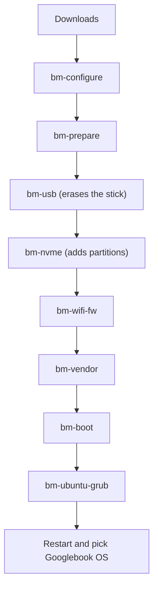

# Installation & Setup Manual

This document provides a comprehensive, start-to-finish guide to installing and running Googlebook OS natively on bare-metal x86_64 laptops alongside existing installations of Ubuntu and Windows.

---

## Table of Contents
1. [Prerequisites & System Requirements](#prerequisites--system-requirements)
2. 2. [Storage Modes (Single-Drive Internal NVMe vs. Dedicated Secondary Drive)](#storage-modes-single-drive-internal-nvme-vs-dedicated-secondary-drive)
   3. 3. [Preparing Unallocated Space](#preparing-unallocated-space)
      4. 4. [Downloading Build Archives](#downloading-build-archives)
         5. 5. [Step-by-Step Installation Pipeline](#step-by-step-installation-pipeline)
            6.    - [Step 1: Install Host Packages](#step-1-install-host-packages)
                  -    - [Step 2: Configure Target Hardware (`bm-configure.sh`)](#step-2-configure-target-hardware-bm-configuresh)
                       -    - [Step 3: Validate & Prepare Build Archives (`bm-check.sh` & `bm-prepare.sh`)](#step-3-validate--prepare-build-archives-bm-checksh--bm-preparesh)
                            -    - [Step 4: Create GPT Partition Structure (`bm-nvme.sh`)](#step-4-create-gpt-partition-structure-bm-nvmesh)
                                 -    - [Step 5: Flash Core Images & Build Custom Vendor Partition (`bm-flash.sh`, `bm-vendor.sh`, `bm-wifi-fw.sh`)](#step-5-flash-core-images--build-custom-vendor-partition-bm-flashsh-bm-vendorsh-bm-wifi-fwsh)
                                      -    - [Step 6: Register Ubuntu GRUB2 Multi-Boot Entry (`bm-ubuntu-grub.sh`)](#step-6-register-ubuntu-grub2-multi-boot-entry-bm-ubuntu-grubsh)
                                           - 6. [First Boot & System Initialization](#first-boot--system-initialization)
                                             7. 7. [Reversion & Uninstallation (`bm-undo.sh`)](#reversion--uninstallation-bm-undosh)
                                                8.
                                                9. ---
                                                10.
                                                11. ## Prerequisites & System Requirements
                                                12.
                                                13. Before beginning the installation, ensure your environment meets the following baseline requirements:
                                                14.
                                                15. | Requirement | Specification | Notes |
                                                16. | :--- | :--- | :--- |
                                                17. | **Host OS** | Ubuntu 22.04 LTS / 24.04 LTS or Debian 12 (x86_64) | Must use GRUB2 as the bootloader. |
                                                18. | **Disk Space** | ~32 GB Unallocated GPT Space | Unallocated free space on primary internal NVMe SSD or dedicated drive. |
                                                19. | **Firmware** | UEFI Mode with Secure Boot Disabled | Secure Boot must be disabled in system BIOS/UEFI settings for Googlebook kernel. |
                                                20. | **Required Packages** | `erofs-utils`, `attr`, `secilc`, `zstd`, `xxd`, `binutils`, `gdisk`, `curl`, `python3` | Installed automatically or via `sudo apt install`. |
                                                21.
                                                22. ---
                                                23.
                                                24. ## Storage Modes (Single-Drive Internal NVMe vs. Dedicated Secondary Drive)
                                                25.
                                                26. Googlebook-asus supports two distinct hardware storage configurations:
                                                27.
                                                28. ### 1. Single-Drive Internal NVMe Mode (Default / Built-In Workflow)
                                                29. In single-drive internal NVMe mode (configured via `NO_USB=1` or automatic detection), Googlebook OS is installed directly onto ~32 GB of unallocated free space located on your main system NVMe drive (`/dev/nvme0n1`), alongside your existing Ubuntu or Windows installation.
                                                30. - **Safety**: `bm-nvme.sh` performs non-destructive GPT editing. It safely backs up your existing primary GPT header (`gpt_backup_header.bin`) before modifying the partition table to insert the necessary Android system partitions (`android_boot`, `android_init_boot`, `android_system`, `android_vendor`, `android_userdata`, etc.).
                                                    - - **Coexistence**: Your current OS partitions (EFI System Partition, Ubuntu root, Windows NTFS) remain untouched.
                                                      -
                                                      - ### 2. Dedicated Secondary Drive Mode
                                                      - If you prefer to install Googlebook OS onto a dedicated secondary NVMe or external target drive (e.g. `/dev/nvme1n1` or `/dev/sdb`), `bm-nvme.sh` formats and partitions the dedicated drive exclusively for Googlebook OS without touching the primary drive's partition table.
                                                      -
                                                      - ---
                                                      -
                                                      - ## Preparing Unallocated Space
                                                      -
                                                      - To install Googlebook OS on a single primary drive alongside Windows or Ubuntu, you must shrink an existing partition to leave at least **32 GB of unallocated space** at the end of the disk:
                                                      -
                                                      - ### Shrinking Partition under Ubuntu:
                                                      - 1. Open GParted (`sudo apt install gparted && sudo gparted`).
                                                        2. 2. Select your main NVMe drive (`/dev/nvme0n1`).
                                                           3. 3. Right-click your main Linux partition (e.g., `/dev/nvme0n1p2`), select **Resize/Move**.
                                                              4. 4. Reduce the partition size by **32768 MB** (~32 GB) to create unallocated space at the end of the disk.
                                                                 5. 5. Click **Apply All Operations**.
                                                                    6.
                                                                    7. ### Shrinking Partition under Windows:
                                                                    8. 1. Press `Win + X` and select **Disk Management**.
                                                                       2. 2. Right-click your `C:` drive or main data volume and select **Shrink Volume**.
                                                                          3. 3. Enter `32768` (MB) as the amount of space to shrink.
                                                                             4. 4. Click **Shrink**. Do NOT format or assign a drive letter to the newly created space—leave it as **Unallocated**.
                                                                                5.
                                                                                6. ---
                                                                                7.
                                                                                8. ## Downloading Build Archives
                                                                                9.
                                                                                10. Googlebook OS requires two build release archives:
                                                                                11. 1. **Googlebook OS Base System Image (`gbos-base-*.tar.zst`)**: Contains the primary Android system, boot, vendor, and userdata images compiled from Android 17 (lapis pipeline).
                                                                                    2. 2. **ASUS Hardware Enablement Pack (`gbos-asus-hw-*.tar.zst`)**: Contains hardware-specific kernel modules, Wi-Fi/Bluetooth firmware blobs, and Cuttlefish/bare-metal translation overlays for x86_64 laptops.
                                                                                       3.
                                                                                       4. Place both `.tar.zst` files inside your project root directory (e.g., `~/gbos`).
                                                                                       5.
                                                                                       6. ---
                                                                                       7.
                                                                                       8. ## Step-by-Step Installation Pipeline
                                                                                       9.
                                                                                       10. Execute all commands from the repository root (`~/gbos`).
                                                                                       11.
                                                                                       12. ### Step 1: Install Host Packages
                                                                                       13. Ensure all essential host utilities are installed:
                                                                                       14. ```bash
                                                                                           sudo apt update && sudo apt install -y erofs-utils attr secilc zstd xxd binutils gdisk curl python3
                                                                                           ```

                                                                                           ### Step 2: Configure Target Hardware (`bm-configure.sh`)
                                                                                           Run `bm-configure.sh` to analyze host hardware and generate `config.env`:
                                                                                           ```bash
                                                                                           sudo ./scripts/bm-configure.sh
                                                                                           ```
                                                                                           - **Output**: Generates `config.env` containing target NVMe SSD serial number, PCI address mappings, Wi-Fi card details, and storage mode selection (`NO_USB=1`).
                                                                                           -
                                                                                           - ### Step 3: Validate & Prepare Build Archives (`bm-check.sh` & `bm-prepare.sh`)
                                                                                           - Validate checksums and extract system components:
                                                                                           - ```bash
                                                                                             ./scripts/bm-check.sh
                                                                                             ./scripts/bm-prepare.sh
                                                                                             ```
                                                                                             - **Output**: Validates archive integrity against SHA256 checksums and unpacks core images into `build/raw/`.
                                                                                             -
                                                                                             - ### Step 4: Create GPT Partition Structure (`bm-nvme.sh`)
                                                                                             - Create the native Android GPT partition table on the unallocated disk space:
                                                                                             - ```bash
                                                                                               sudo ./scripts/bm-nvme.sh
                                                                                               ```
                                                                                               - **Output**: Backs up existing GPT header to `gpt_backup_header.bin`, creates Android system partitions on unallocated disk space, and re-reads partition table (`partprobe`).
                                                                                               -
                                                                                               - ### Step 5: Flash Core Images & Build Custom Vendor Partition (`bm-flash.sh`, `bm-vendor.sh`, `bm-wifi-fw.sh`)
                                                                                               - Flash images, construct the custom EROFS vendor image, and inject host Wi-Fi/Bluetooth firmware blobs:
                                                                                               - ```bash
                                                                                                 sudo ./scripts/bm-flash.sh
                                                                                                 sudo ./scripts/bm-vendor.sh
                                                                                                 sudo ./scripts/bm-wifi-fw.sh
                                                                                                 ```
                                                                                                 - **Output**: Writes boot, init_boot, and system images to target partitions; builds customized EROFS vendor image with updated SELinux rules and Cuttlefish overrides; extracts host Wi-Fi/Bluetooth firmware binaries directly into vendor firmware overlay.
                                                                                                 -
                                                                                                 - ### Step 6: Register Ubuntu GRUB2 Multi-Boot Entry (`bm-ubuntu-grub.sh`)
                                                                                                 - Add Googlebook OS to your host Ubuntu GRUB boot menu:
                                                                                                 - ```bash
                                                                                                   sudo ./scripts/bm-ubuntu-grub.sh
                                                                                                   ```
                                                                                                   - **Output**: Generates `/etc/grub.d/40_googlebook` entry and updates GRUB (`update-grub`), allowing seamless dual-boot selection at startup.
                                                                                                   -
                                                                                                   - ---
                                                                                                   -
                                                                                                   - ## First Boot & System Initialization
                                                                                                   -
                                                                                                   - 1. Reboot your laptop (`sudo reboot`).
                                                                                                     2. 2. At the GRUB boot menu, select **Googlebook OS (Android 17 x86_64)**.
                                                                                                        3. 3. System will boot bare-metal Android 17. The first boot initializes userdata space and takes approximately 45–60 seconds.
                                                                                                           4.
                                                                                                           5. ---
                                                                                                           6.
                                                                                                           7. ## Reversion & Uninstallation (`bm-undo.sh`)
                                                                                                           8.
                                                                                                           9. To cleanly remove Googlebook OS and restore your original GPT partition header:
                                                                                                           10. ```bash
                                                                                                               sudo ./scripts/bm-undo.sh
                                                                                                               ```
                                                                                                               `bm-undo.sh` removes the GRUB menu entry, restores the original pre-installation GPT header from `gpt_backup_header.bin`, and frees the allocated Android space.
                                                                                                               )
- [1. Get the project and the downloads](#1-get-the-project-and-the-downloads)
- [2. Detect your hardware](#2-detect-your-hardware)
- [3. Unpack the downloads](#3-unpack-the-downloads)
- [4. Install Android](#4-install-android)
- [5. First boot](#5-first-boot)
- [Undo](#undo)



For installation without a USB stick, use [USB-FREE.md](USB-FREE.md).

## Before you start

**You need**

| | |
|---|---|
| Laptop | Intel CPU and GPU, UEFI firmware. Tested only on an ASUS TUF F16 (see [Hardware](HARDWARE.md)) |
| Ubuntu | Already installed. It runs the scripts and hosts the boot menu |
| SSD space | About **60 GB unallocated** (not inside an existing partition). The system part takes about 20 GB; the data area is 40 GB by default and shrinks to 16 GB if space is short |
| USB stick | **32 GB or more**. It is erased. You only need it during setup |
| Disk space for the files | About 80 GB free in the project folder while preparing |
| Time | A few hours, mostly downloads and waiting |

**Do these first**

> [!IMPORTANT]
> - **Turn off Secure Boot** in the firmware settings. The Googlebook kernel is not signed.
> - If you use **BitLocker** on Windows, have your recovery key ready. Windows may ask for it once after firmware changes.
> - **Back up anything important.** Do not skip this.

## 1. Get the project and the downloads

**Install the tools**

```bash
sudo apt install git python3 unzip curl lz4 erofs-utils e2fsprogs mkbootimg attr binutils cpio xxd zstd secilc gdisk parted rsync dosfstools grub-efi-amd64-bin file openssl pciutils
```

**Get the scripts** (the folder will also hold the large working files):

```bash
git clone https://github.com/paulst8/Googlebook-asus ~/gbos
cd ~/gbos
```

**Download two files** into that folder, with exactly these names:

1. **Google's Googlebook OS recovery image** for the ASUS *lapis* device, saved as `lapis-recovery.zip` (build 16452207, about 7 GB):
   ```
   https://dl.google.com/device/recovery/lapis-user/16452207/recovery.zip
   ```
   Its MD5 should be `38873eac8ff5b060baf229b7bcf7ec05` (check with `md5sum lapis-recovery.zip`). The [cros.tech Googlebooks list](https://cros.tech/googlebooks/) shows every model's current build.
2. **The Android Cuttlefish test image**, saved as `aosp_cf_x86_64_only_phone-img-16373615.zip`. Open [this build page](https://ci.android.com/builds/submitted/16373615/aosp_cf_x86_64_only_phone-userdebug/), open its *Artifacts* list, and download that file. The vendor script borrows its software security and graphics parts.

> [!NOTE]
> The Cuttlefish build page can expire. If it has, use the closest newer `aosp_cf_x86_64_only_phone-userdebug` build and change the file name in `scripts/bm-prepare.sh` to match. That is untested.

## 2. Detect your hardware

Plug in the USB stick, then run:

```bash
bash scripts/bm-configure.sh
```

It asks which of your drives is the SSD and which is the stick, and detects your GPU and the firmware your Ubuntu loads for Wi-Fi, Bluetooth and Ethernet. It saves everything in `bm.conf` and lists anything it could not match. Nothing is written to your disks.

> [!TIP]
> Run it with `sudo` once if it says the kernel log is not readable: the firmware detection then finds more. Both runs write the same `bm.conf`.

Then check that you have everything:

```bash
bash scripts/bm-check.sh
```

It shows your settings, the tools and downloads still missing, and the free space on your SSD.

## 3. Unpack the downloads

```bash
bash scripts/bm-prepare.sh
```

No sudo, about 10 to 20 minutes. It unzips Google's image, splits out the kernel, boot files and system partitions, unpacks the Cuttlefish parts, and makes a working copy. It ends with "All set". If it lists something missing, fix that first.

## 4. Install Android

Each script below asks you to type something before it erases or writes anything.

### 4.1 Prepare the stick (erases the stick)

```bash
sudo bash scripts/bm-usb.sh
```

Copies Android's partitions onto the stick and sets up a small boot partition. About 10 minutes. On a 32 GB stick use `sudo USERDATA_GIB=4 bash scripts/bm-usb.sh`.

### 4.2 Add Android's partitions to your SSD (adds partitions only)

```bash
sudo DRYRUN=1 bash scripts/bm-nvme.sh     # preview the plan first
sudo bash scripts/bm-nvme.sh
```

The installer now reads the prepared images directly; the stick is not required for this step. This only **adds** new partitions in unallocated space. It saves a copy of your partition table first (`nvme-<serial>-gpt-backup-*.bin`). Keep that file.

### 4.3 Get newer Wi-Fi firmware

```bash
bash scripts/bm-wifi-fw.sh
```

Ubuntu's copy of the Intel Wi-Fi firmware is too old for the Googlebook kernel. This downloads newer versions for your chip family. If it can't find any, `bash scripts/bm-wifi-fw2.sh` searches older versions in the firmware git history.

### 4.4 Build the vendor part for your laptop

```bash
sudo bash scripts/bm-vendor.sh
```

About 10 minutes. This holds the firmware, sound and security-chip fixes, and writes the result to your SSD.

### 4.5 Write the kernel and boot settings

```bash
sudo bash scripts/bm-boot.sh
```

### 4.6 Add Googlebook OS to Ubuntu's boot menu (stick still plugged in)

```bash
sudo bash scripts/bm-ubuntu-grub.sh
```

This copies the kernel and boot settings (about 60 MB) to `/boot/gbos` and adds the entries to Ubuntu's GRUB. After this you no longer need the stick to boot.

## 5. First boot

Restart. If Ubuntu's menu is hidden, hold **Shift** or **Esc** while the laptop starts. Pick **Googlebook OS**. The first boot takes several minutes and then runs the normal Android setup.

If you want a tidy menu (one entry plus a submenu instead of several), run `sudo bash scripts/bm-finalize.sh` once you have a working boot. It does not change your default entry.

To change kernel options later, plug the stick back in and repeat steps 4.5 and 4.6.

<details>
<summary><strong>Something went wrong during setup?</strong></summary>

- A script stopped with "run bm-configure.sh first": run step 2.
- `bm-prepare.sh` lists a missing tool: install it with the `apt` line above.
- `bm-nvme.sh` says there is not enough free space: you need about 60 GB unallocated. Shrink a partition with a partition tool first (back up before you do).
- Boot problems and known issues: [Troubleshooting](TROUBLESHOOTING.md).

</details>

## Useful extras

| Script | What it does |
|---|---|
| `scripts/bm-wipe-userdata.sh` | Factory-resets Googlebook OS only |
| `scripts/bm-reset-data.sh` | Factory reset that also clears the data key (needed when switching between locked and unlocked) |
| `scripts/bm-grow.sh` | Makes the Android data partition bigger (erases it) |
| `scripts/bm-boottime.sh` | Shows where boot time is spent (needs adb) |
| `scripts/bm-finalize.sh` | Tidies the Googlebook entries in Ubuntu's boot menu |

## Undo

- **Boot entry:** `sudo rm -rf /boot/gbos /etc/grub.d/40_googlebook /etc/grub.d/41_googlebook_verified /etc/grub.d/42_googlebook_locked && sudo update-grub`
- **Android's partitions:** restore the saved partition table with `sudo sgdisk --load-backup=<the backup file> /dev/<your SSD>`. This removes the added partitions and gives you the free space back.
- Existing OS partitions are intended to be preserved. Ubuntu boot files and GRUB configuration are changed. Restoring a GPT backup replaces the entire partition map; do not do that after other partition changes.
