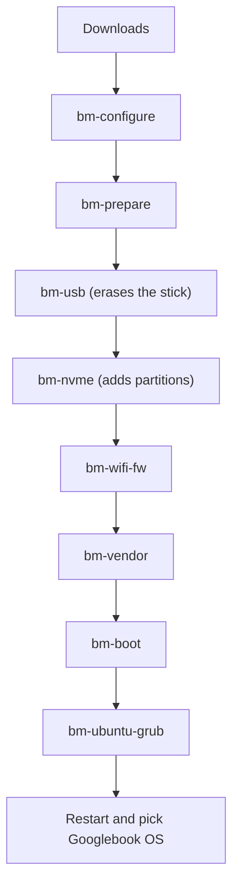

# Setup guide

Everything from the downloads to the first boot. Run all commands in **Ubuntu**, from the project folder (`~/gbos` below). Read each step before you run it: several of them write to disks.

- [Before you start](#before-you-start)
- [1. Get the project and the downloads](#1-get-the-project-and-the-downloads)
- [2. Detect your hardware](#2-detect-your-hardware)
- [3. Unpack the downloads](#3-unpack-the-downloads)
- [4. Install Android](#4-install-android)
- [5. First boot](#5-first-boot)
- [Undo](#undo)



For installation without a USB stick, use [USB-FREE.md](USB-FREE.md).

## Before you start

**You need**

| | |
|---|---|
| Laptop | Intel CPU and GPU, UEFI firmware. Tested only on an ASUS TUF F16 (see [Hardware](HARDWARE.md)) |
| Ubuntu | Already installed. It runs the scripts and hosts the boot menu |
| SSD space | About **60 GB unallocated** (not inside an existing partition). The system part takes about 20 GB; the data area is 40 GB by default and shrinks to 16 GB if space is short |
| USB stick | **32 GB or more**. It is erased. You only need it during setup |
| Disk space for the files | About 80 GB free in the project folder while preparing |
| Time | A few hours, mostly downloads and waiting |

**Do these first**

> [!IMPORTANT]
> - **Turn off Secure Boot** in the firmware settings. The Googlebook kernel is not signed.
> - If you use **BitLocker** on Windows, have your recovery key ready. Windows may ask for it once after firmware changes.
> - **Back up anything important.** Do not skip this.

## 1. Get the project and the downloads

**Install the tools**

```bash
sudo apt install git python3 unzip curl lz4 erofs-utils e2fsprogs mkbootimg attr binutils cpio xxd zstd secilc gdisk parted rsync dosfstools grub-efi-amd64-bin file openssl pciutils
```

**Get the scripts** (the folder will also hold the large working files):

```bash
git clone https://github.com/paulst8/Googlebook-asus ~/gbos
cd ~/gbos
```

**Download two files** into that folder, with exactly these names:

1. **Google's Googlebook OS recovery image** for the ASUS *lapis* device, saved as `lapis-recovery.zip` (build 16452207, about 7 GB):
   ```
   https://dl.google.com/device/recovery/lapis-user/16452207/recovery.zip
   ```
   Its MD5 should be `38873eac8ff5b060baf229b7bcf7ec05` (check with `md5sum lapis-recovery.zip`). The [cros.tech Googlebooks list](https://cros.tech/googlebooks/) shows every model's current build.
2. **The Android Cuttlefish test image**, saved as `aosp_cf_x86_64_only_phone-img-16373615.zip`. Open [this build page](https://ci.android.com/builds/submitted/16373615/aosp_cf_x86_64_only_phone-userdebug/), open its *Artifacts* list, and download that file. The vendor script borrows its software security and graphics parts.

> [!NOTE]
> The Cuttlefish build page can expire. If it has, use the closest newer `aosp_cf_x86_64_only_phone-userdebug` build and change the file name in `scripts/bm-prepare.sh` to match. That is untested.

## 2. Detect your hardware

Plug in the USB stick, then run:

```bash
bash scripts/bm-configure.sh
```

It asks which of your drives is the SSD and which is the stick, and detects your GPU and the firmware your Ubuntu loads for Wi-Fi, Bluetooth and Ethernet. It saves everything in `bm.conf` and lists anything it could not match. Nothing is written to your disks.

> [!TIP]
> Run it with `sudo` once if it says the kernel log is not readable: the firmware detection then finds more. Both runs write the same `bm.conf`.

Then check that you have everything:

```bash
bash scripts/bm-check.sh
```

It shows your settings, the tools and downloads still missing, and the free space on your SSD.

## 3. Unpack the downloads

```bash
bash scripts/bm-prepare.sh
```

No sudo, about 10 to 20 minutes. It unzips Google's image, splits out the kernel, boot files and system partitions, unpacks the Cuttlefish parts, and makes a working copy. It ends with "All set". If it lists something missing, fix that first.

## 4. Install Android

Each script below asks you to type something before it erases or writes anything.

### 4.1 Prepare the stick (erases the stick)

```bash
sudo bash scripts/bm-usb.sh
```

Copies Android's partitions onto the stick and sets up a small boot partition. About 10 minutes. On a 32 GB stick use `sudo USERDATA_GIB=4 bash scripts/bm-usb.sh`.

### 4.2 Add Android's partitions to your SSD (adds partitions only)

```bash
sudo DRYRUN=1 bash scripts/bm-nvme.sh     # preview the plan first
sudo bash scripts/bm-nvme.sh
```

The installer now reads the prepared images directly; the stick is not required for this step. This only **adds** new partitions in unallocated space. It saves a copy of your partition table first (`nvme-<serial>-gpt-backup-*.bin`). Keep that file.

### 4.3 Get newer Wi-Fi firmware

```bash
bash scripts/bm-wifi-fw.sh
```

Ubuntu's copy of the Intel Wi-Fi firmware is too old for the Googlebook kernel. This downloads newer versions for your chip family. If it can't find any, `bash scripts/bm-wifi-fw2.sh` searches older versions in the firmware git history.

### 4.4 Build the vendor part for your laptop

```bash
sudo bash scripts/bm-vendor.sh
```

About 10 minutes. This holds the firmware, sound and security-chip fixes, and writes the result to your SSD.

### 4.5 Write the kernel and boot settings

```bash
sudo bash scripts/bm-boot.sh
```

### 4.6 Add Googlebook OS to Ubuntu's boot menu (stick still plugged in)

```bash
sudo bash scripts/bm-ubuntu-grub.sh
```

This copies the kernel and boot settings (about 60 MB) to `/boot/gbos` and adds the entries to Ubuntu's GRUB. After this you no longer need the stick to boot.

## 5. First boot

Restart. If Ubuntu's menu is hidden, hold **Shift** or **Esc** while the laptop starts. Pick **Googlebook OS**. The first boot takes several minutes and then runs the normal Android setup.

If you want a tidy menu (one entry plus a submenu instead of several), run `sudo bash scripts/bm-finalize.sh` once you have a working boot. It does not change your default entry.

To change kernel options later, plug the stick back in and repeat steps 4.5 and 4.6.

<details>
<summary><strong>Something went wrong during setup?</strong></summary>

- A script stopped with "run bm-configure.sh first": run step 2.
- `bm-prepare.sh` lists a missing tool: install it with the `apt` line above.
- `bm-nvme.sh` says there is not enough free space: you need about 60 GB unallocated. Shrink a partition with a partition tool first (back up before you do).
- Boot problems and known issues: [Troubleshooting](TROUBLESHOOTING.md).

</details>

## Useful extras

| Script | What it does |
|---|---|
| `scripts/bm-wipe-userdata.sh` | Factory-resets Googlebook OS only |
| `scripts/bm-reset-data.sh` | Factory reset that also clears the data key (needed when switching between locked and unlocked) |
| `scripts/bm-grow.sh` | Makes the Android data partition bigger (erases it) |
| `scripts/bm-boottime.sh` | Shows where boot time is spent (needs adb) |
| `scripts/bm-finalize.sh` | Tidies the Googlebook entries in Ubuntu's boot menu |

## Undo

- **Boot entry:** `sudo rm -rf /boot/gbos /etc/grub.d/40_googlebook /etc/grub.d/41_googlebook_verified /etc/grub.d/42_googlebook_locked && sudo update-grub`
- **Android's partitions:** restore the saved partition table with `sudo sgdisk --load-backup=<the backup file> /dev/<your SSD>`. This removes the added partitions and gives you the free space back.
- Existing OS partitions are intended to be preserved. Ubuntu boot files and GRUB configuration are changed. Restoring a GPT backup replaces the entire partition map; do not do that after other partition changes.
